# Raounak Djebir – Personal Portfolio

**Student name:** DJEBIR Raounak

---

## Project Description

This project is my personal portfolio website. It presents who I am as an AI engineering student, the projects I have built, the tools I use, my certificates and my experience, and gives visitors a simple way to contact me. It is a static website made of one HTML page, one stylesheet and one JavaScript file. It is not deployed online and runs by opening `index.html` in a browser.

The page is divided into the following sections, each with its own purpose:

### 1. Header and navigation
A fixed bar at the top of the page with my name, links to every section (About, Projects, Tech stack, Certificates, Experience, Contact) and a button to switch between the dark and light theme. It stays visible while scrolling so the visitor can jump to any section quickly.

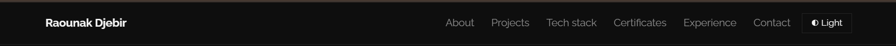

### 2. Hero (introduction)
The first thing a visitor sees. It contains a greeting, my name, my role (AI Engineering Student at ENSTA Algiers) and a one-line summary of what I do: building machine learning systems end to end, from data and models to APIs and interfaces. It also has quick icon links to my email, GitHub and LinkedIn, an "Explore my work" button, and a code-style card (`profile.py`) that summarizes my profile, focus areas, stack and what I am open to.

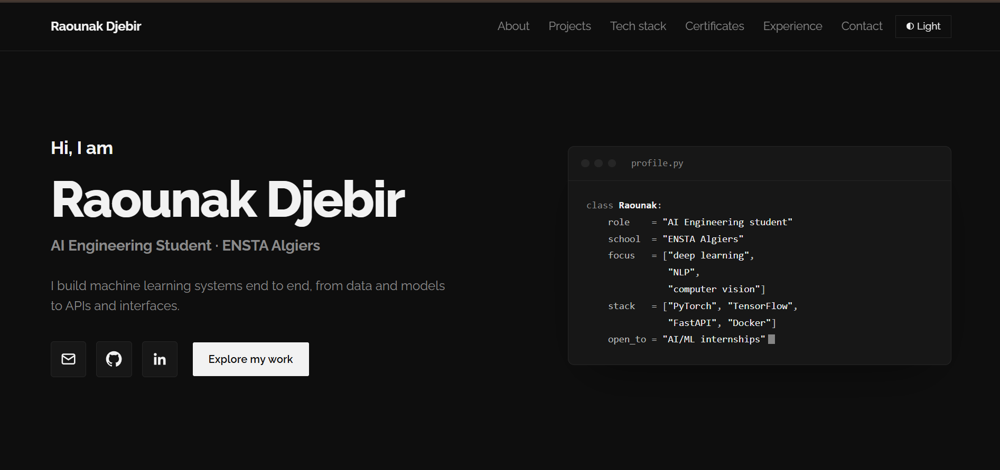

### 3. About
A short presentation of my background and interests: end-to-end machine learning systems, deep learning, NLP, computer vision, time-series forecasting and ML deployment, plus my design and team management experience at Shellmates Club. Next to the text are my profile photo and a quick-facts card (degree, school, languages, focus). It ends with what I am open to: AI/ML internships, research collaborations and open-source contributions.

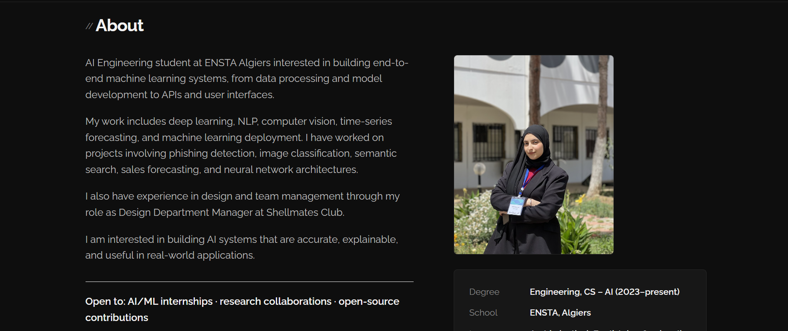

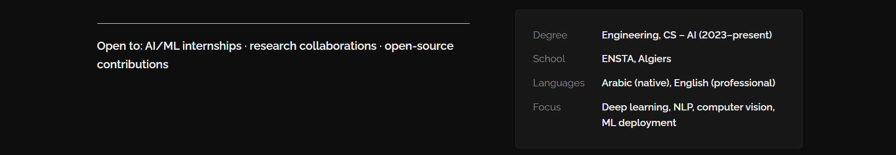

### 4. Projects
The main section of the portfolio. Each project has a title, a category, a description and either a GitHub link or a "Repository link coming soon" note:

- **Distracted Driver Detection**: classifies driver images into 10 behavior categories using ResNet50 (from scratch and with transfer learning), with the validation results shown in a table and a short analysis of overfitting.
- **Multi-Store Sales Forecasting**: predicts monthly product sales for different shops with XGBoost and serves predictions through a FastAPI API with Docker support and tests.
- **Transformer From Scratch**: a PyTorch implementation of the model from the paper "Attention Is All You Need".
- **Human Activity Detection** (in development): a web app that recognizes human actions in video using Detectron2 pose estimation and an LSTM classifier.
- **Phishing Detection** (in development): a Telegram bot that analyzes email files and checks SPF, DKIM, DMARC, typosquatting, spoofing and VirusTotal, combined with machine learning classification.
- **Medical Chatbot** (in development): a Flask chatbot built with PyTorch and NLTK.

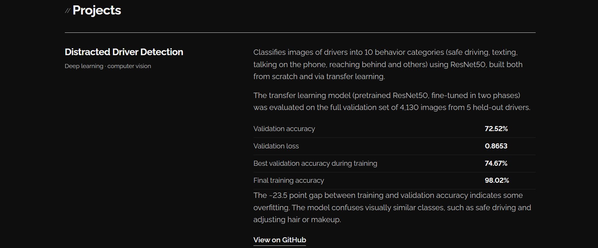

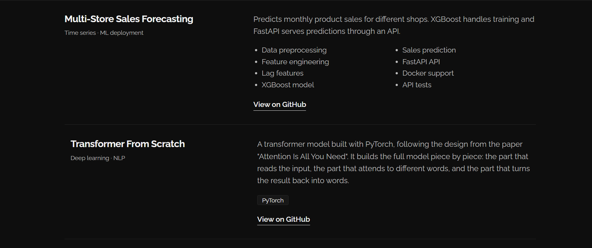

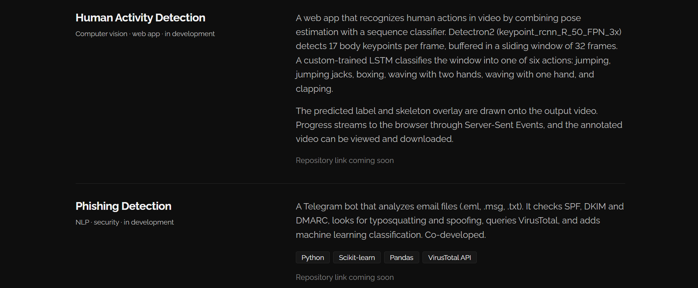

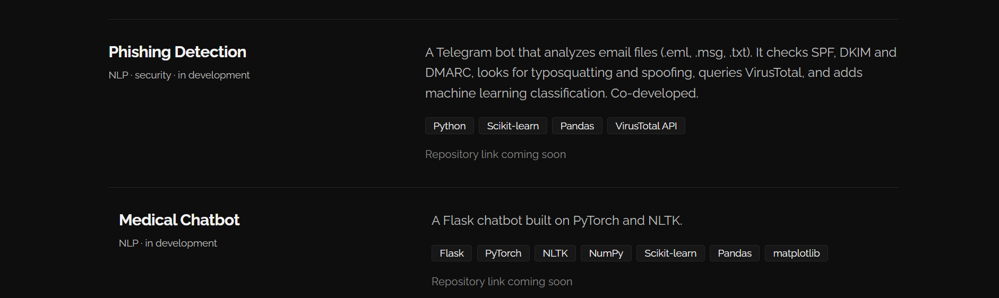

### 5. Tech stack
The tools and technologies I work with, grouped by category: languages, machine learning and AI, data science, frontend and design, and tools and infrastructure.

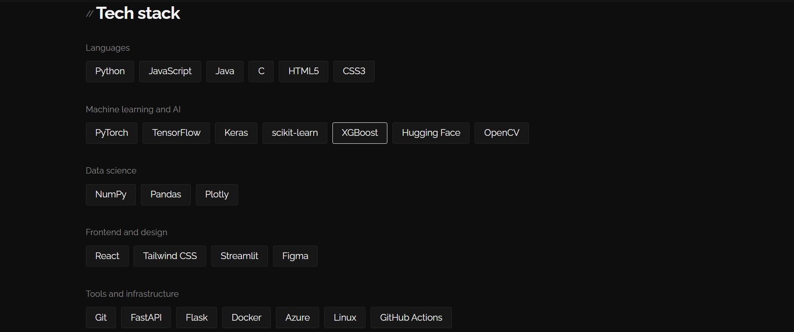

### 6. Certificates
A list of my certificates (DataCamp, ICAIRE / Microsoft Azure). Each one is a collapsible item that shows more details (hours, completion date) when clicked.

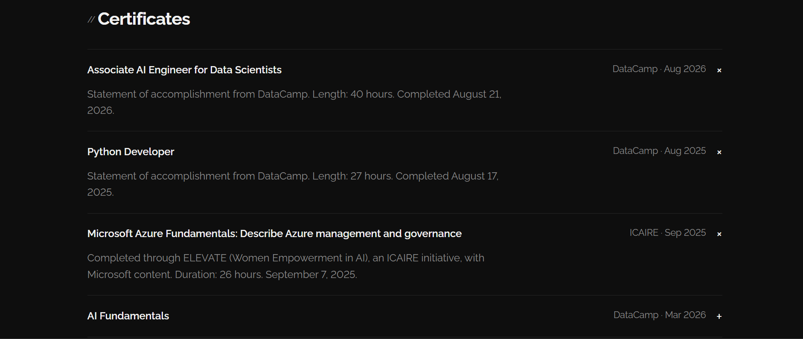

### 7. Experience
A timeline of my experience: Design Department Manager at Shellmates Club, an observation internship in Technology and AI at ERSTC (Constantine), and a frontend academic project (Amanah) at ENSTA Algiers.

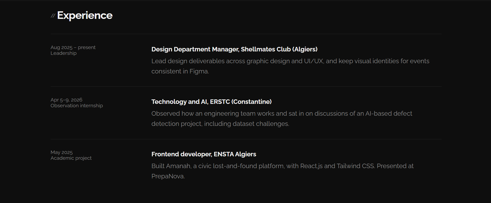

### 8. Contact
A closing section stating that I am open to AI/ML internships, research collaborations and open-source contributions, with large icon links to my email, GitHub and LinkedIn.

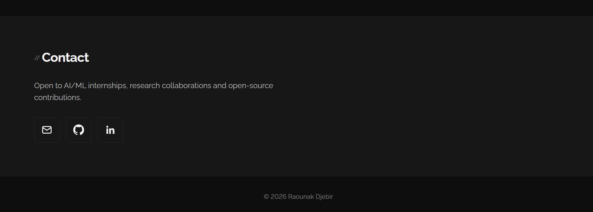

### 9. Light theme
The whole site can be switched to a light theme with the toggle button in the header. The choice is remembered in the browser.

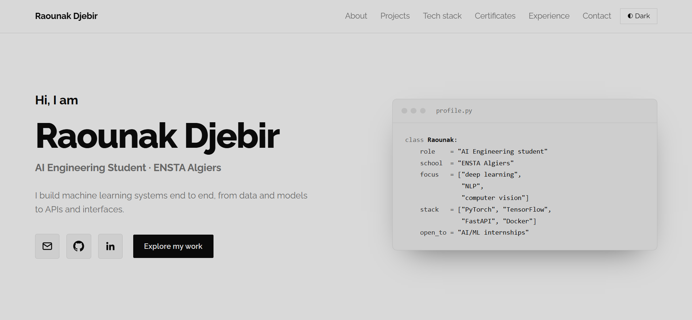

### 10. Mobile version
The layout adapts to small screens: the sections stack vertically and the navigation shrinks to fit.

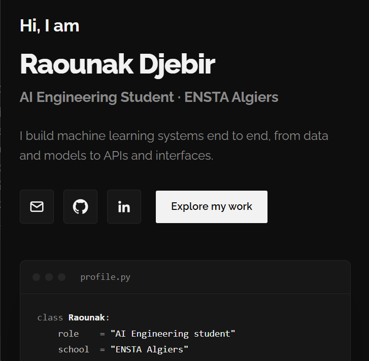

---

## Technologies Used

- **HTML5**: semantic page structure (header, nav, main, sections, article, details/summary, table, footer)
- **CSS3**: custom properties (variables) for theming, Flexbox and CSS Grid layouts, responsive media queries, transitions and animations
- **JavaScript (vanilla)**: theme toggle, scroll animations and profile photo loading
- **Google Fonts**: Raleway typeface
- **Inline SVG**: email, GitHub and LinkedIn icons

No frameworks or libraries are used.

---

## Implemented Features

- **Dark and light theme** with a toggle button; the choice is saved in `localStorage` and dark is the default
- **Fully responsive design** that adapts to desktop, tablet and mobile screens
- **Scroll reveal animations** on each section using `IntersectionObserver`
- **Fixed navigation bar** with smooth scrolling to each section
- **Animated terminal-style profile card** with a blinking cursor in the hero
- **Collapsible certificates** using `details` and `summary`
- **Hover effects** on buttons, icons, project rows and tech stack tags
- **Profile photo with fallback**: tries several common file names and shows a placeholder if none is found
- **Accessibility**: skip-to-content link, ARIA labels, visible focus outlines, semantic HTML and support for `prefers-reduced-motion`
- **Works without JavaScript**: content stays visible if JavaScript is disabled
- **Direct contact and social links** (email, GitHub, LinkedIn)

---

## Project Structure

```
portfolio/
├── index.html
├── css/
│   └── style.css
├── js/
│   └── main.js
├── screenshots/
│   ├── header.png
│   ├── hero.png
│   ├── about.png
│   ├── about2.png
│   ├── projects1.png
│   ├── projects2.png
│   ├── projects3.png
│   ├── projects4.png
│   ├── tech-stack.png
│   ├── certificates.png
│   ├── experience.png
│   ├── contact.png
│   ├── light-theme.png
│   └── mobile.png
├── profile.jpg
└── README.md
```

## How to Run

1. Download or clone the repository.
2. Open `index.html` in any modern web browser.

## Contact

- Email: djebir.raounak@gmail.com
- GitHub: https://github.com/raw-djb
- LinkedIn: https://www.linkedin.com/in/raounak-djebir-535a83301/
